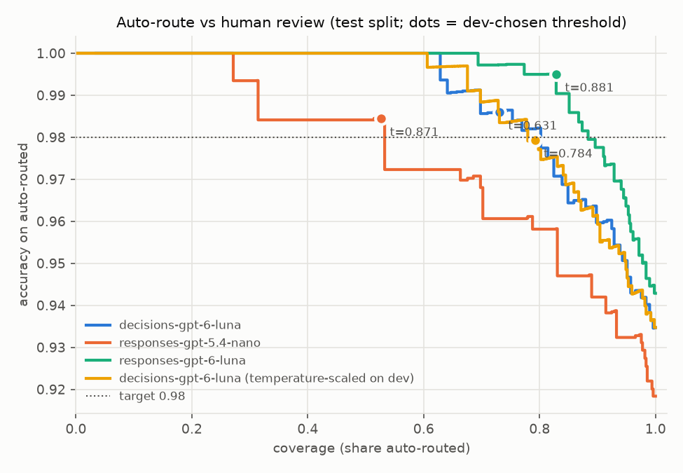
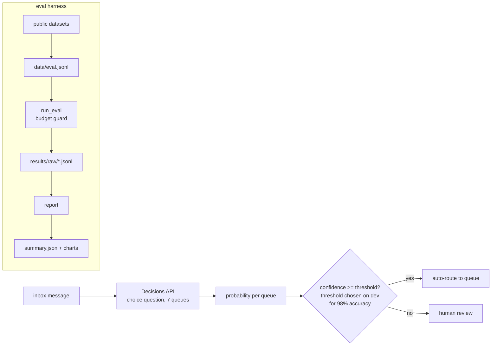

# decision-triage

[](https://github.com/PeterP22/decision-triage/actions/workflows/ci.yml)
[](LICENSE)

Confidence-gated inbox triage on OpenAI's Decisions API, measured against Responses API structured output.

**Decisions: 8.2x lower p50 latency (130 ms vs 1065 ms) and 24% lower cost per 1k messages ($0.0231 vs $0.0305) than the same model (gpt-6-luna) through Responses, at 93.5% vs 94.3% test accuracy.**



## How it works



## Key decisions

- Thresholds are chosen on the dev split (210 messages) for 98% accuracy on auto-routed messages and reported on the untouched test split (490).
- The same model, gpt-6-luna, runs through both APIs, so differences come from the API; gpt-5.4-nano through Responses is a small-model baseline.
- `run_eval` reserves each call's estimated cost before sending it and stops before `--budget-usd` would be exceeded.
- What didn't work: raw Decisions probabilities are under-confident (ECE 0.167). One-parameter temperature scaling fitted on dev fixes it (ECE 0.048, T=0.57). Responses returns one verbalised confidence, not a distribution, so it is reported raw.
- Lower latency and cost do not imply more auto-routing. At the 98% target, test coverage is 73.1% for Decisions raw, 79.2% temperature-scaled, and 82.9% for gpt-6-luna through Responses.

## Results

| Method | Test accuracy | ECE | AURC (lower is better) | p50 / p95 latency (ms) | $ per 1k messages | Auto-routed at 98% target: coverage, accuracy (test) |
|---|---|---|---|---|---|---|
| decisions gpt-6-luna | 93.5% | 0.167 | 0.0102 | 130 / 171 | $0.0231 | 73.1%, 98.6% |
| decisions gpt-6-luna (temperature-scaled) | 93.5% | 0.048 | 0.0103 | 130 / 171 | $0.0231 | 79.2%, 97.9% |
| responses gpt-6-luna | 94.3% | 0.031 | 0.0051 | 1065 / 1549 | $0.0305 | 82.9%, 99.5% |
| responses gpt-5.4-nano | 91.8% | 0.078 | 0.0217 | 790 / 1196 | $0.0657 | 52.7%, 98.4% |

Data: 700 public messages (210 dev / 490 test, 7 queues) from Bitext customer-support (CDLA-Sharing-1.0) and UCI SMS Spam (CC BY 4.0); no real personal emails. See [data/README.md](data/README.md).
Latency is client-side wall clock at concurrency 4 from a Sydney VM. Cost is usage x list price (17 Oct 2026).
Total computed spend for all runs: $0.0835 (not a billing statement).

Calibration per method: [docs/reliability.png](docs/reliability.png).

## Quickstart

```bash
git clone https://github.com/PeterP22/decision-triage && cd decision-triage && pip install -e ".[dev]"
python -m decision_triage.run_eval --method decisions --out results/raw/decisions-gpt-6-luna.jsonl --budget-usd 0.10
python -m decision_triage.report
```

MIT · built by Peter Preketes
