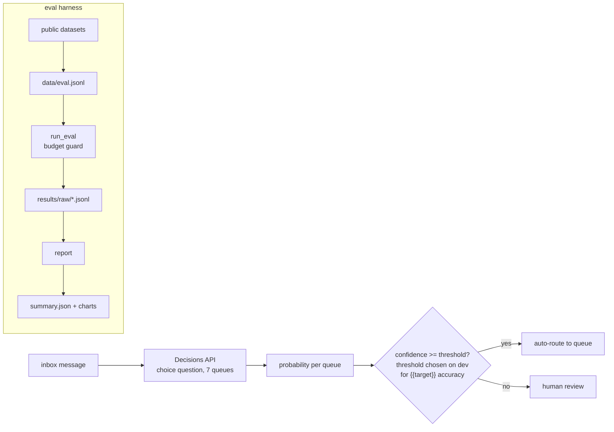

# decision-triage

[](https://github.com/PeterP22/decision-triage/actions/workflows/ci.yml)
[](LICENSE)

Confidence-gated inbox triage on OpenAI's Decisions API, measured against Responses API structured output.

**Decisions: {{headline.latency_ratio}}x lower p50 latency ({{decisions.p50_ms}} ms vs {{responses.p50_ms}} ms) and {{headline.cost_reduction_pct}} lower cost per 1k messages ({{decisions.cost_per_1k}} vs {{responses.cost_per_1k}}) than the same model (gpt-6-luna) through Responses, at {{decisions.accuracy}} vs {{responses.accuracy}} test accuracy.**


## How it works



## Key decisions

- Thresholds are chosen on the dev split ({{decisions.n_dev}} messages) for {{target}} accuracy on auto-routed messages and reported on the untouched test split ({{decisions.n_test}}).
- The same model, gpt-6-luna, runs through both APIs, so differences come from the API; gpt-5.4-nano through Responses is a small-model baseline.
- `run_eval` reserves each call's estimated cost before sending it and stops before `--budget-usd` would be exceeded.
- What didn't work: raw Decisions probabilities are under-confident (ECE {{decisions.ece}}). One-parameter temperature scaling fitted on dev fixes it (ECE {{decisions.ece_calibrated}}, T={{decisions.temperature}}). Responses returns one verbalised confidence, not a distribution, so it is reported raw.
- Lower latency and cost do not imply more auto-routing. At the {{target}} target, test coverage is {{decisions.coverage}} for Decisions raw, {{decisions_ts.coverage}} temperature-scaled, and {{responses.coverage}} for gpt-6-luna through Responses.

## Results

| Method | Test accuracy | ECE | AURC (lower is better) | p50 / p95 latency (ms) | $ per 1k messages | Auto-routed at {{target}} target: coverage, accuracy (test) |
|---|---|---|---|---|---|---|
| decisions gpt-6-luna | {{decisions.accuracy}} | {{decisions.ece}} | {{decisions.aurc}} | {{decisions.p50_ms}} / {{decisions.p95_ms}} | {{decisions.cost_per_1k}} | {{decisions.coverage}}, {{decisions.coverage_accuracy}} |
| decisions gpt-6-luna (temperature-scaled) | {{decisions_ts.accuracy}} | {{decisions_ts.ece}} | {{decisions_ts.aurc}} | {{decisions_ts.p50_ms}} / {{decisions_ts.p95_ms}} | {{decisions_ts.cost_per_1k}} | {{decisions_ts.coverage}}, {{decisions_ts.coverage_accuracy}} |
| responses gpt-6-luna | {{responses.accuracy}} | {{responses.ece}} | {{responses.aurc}} | {{responses.p50_ms}} / {{responses.p95_ms}} | {{responses.cost_per_1k}} | {{responses.coverage}}, {{responses.coverage_accuracy}} |
| responses gpt-5.4-nano | {{nano.accuracy}} | {{nano.ece}} | {{nano.aurc}} | {{nano.p50_ms}} / {{nano.p95_ms}} | {{nano.cost_per_1k}} | {{nano.coverage}}, {{nano.coverage_accuracy}} |

Data: {{decisions.n}} public messages ({{decisions.n_dev}} dev / {{decisions.n_test}} test, 7 queues) from Bitext customer-support (CDLA-Sharing-1.0) and UCI SMS Spam (CC BY 4.0); no real personal emails. See [data/README.md](data/README.md).
Latency is client-side wall clock at concurrency 4 from a Sydney VM. Cost is usage x list price (17 Oct 2026).
Total computed spend for all runs: {{total_spend}} (not a billing statement).

Calibration per method: [docs/reliability.png](docs/reliability.png).

## Quickstart

```bash
git clone https://github.com/PeterP22/decision-triage && cd decision-triage && pip install -e ".[dev]"
python -m decision_triage.run_eval --method decisions --out results/raw/decisions-gpt-6-luna.jsonl --budget-usd 0.10
python -m decision_triage.report
```

MIT · built by Peter Preketes
